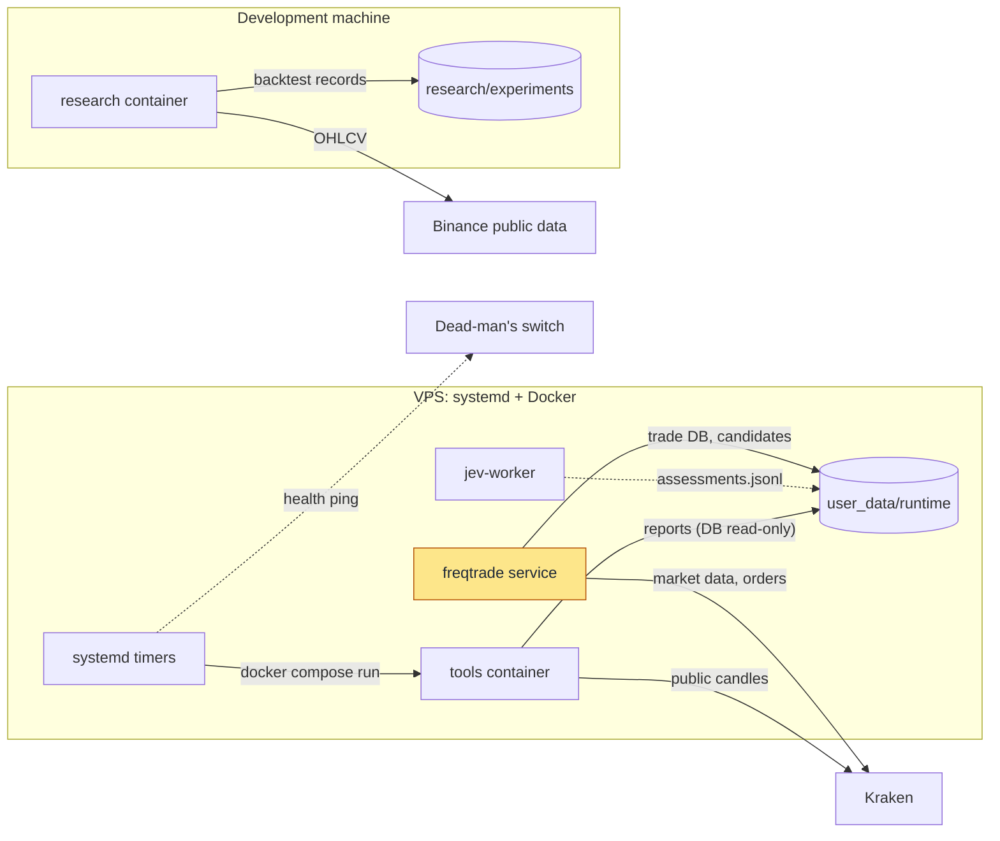
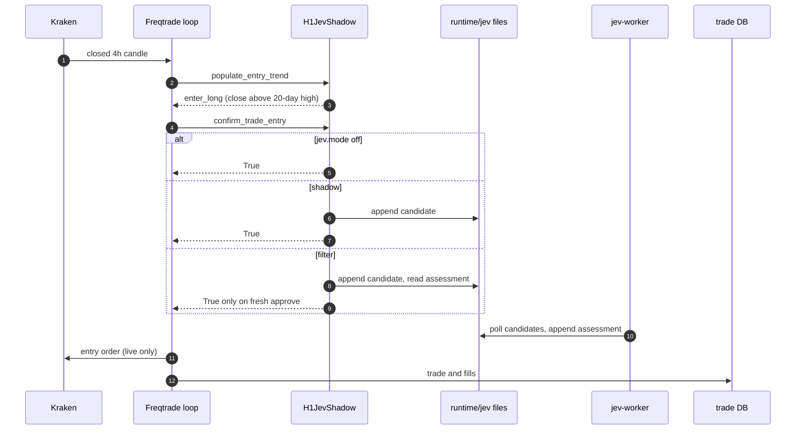
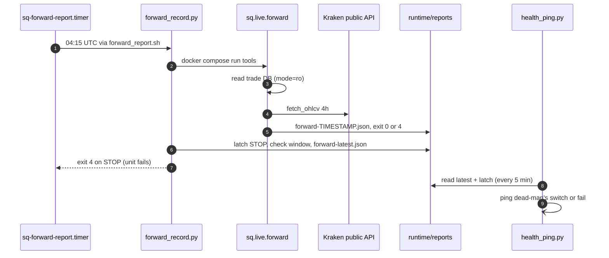
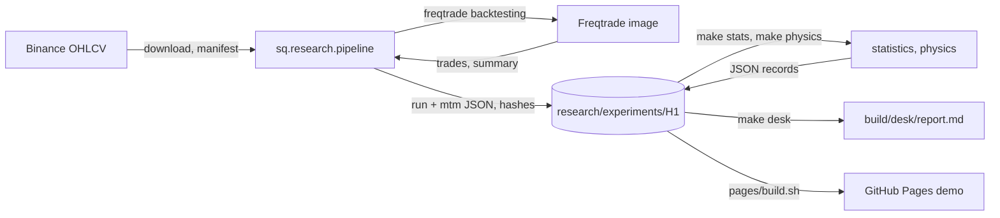
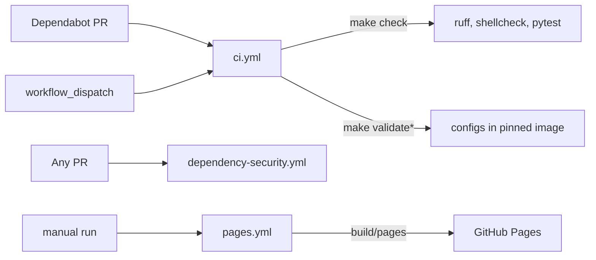

# Architecture

This page defines the system boundaries and ownership. What exists and what is
verified is tracked in [status](status.md).

## Principle

Freqtrade is the only order engine. It owns market data, strategy execution,
orders, fills, trade state, restart recovery, protections, the API server and
Telegram control. Project code adds strategies, configuration layers, read-only
checks, research tooling, an optional model worker and host operations around
it. Custom execution infrastructure (an intent journal, a supervisor) is added
only when a drill shows a gap in Freqtrade.

## How it works

Five diagrams for a first read. The tables and rules further down are the
reference; this section shows how the parts connect.

### What runs where

The system has two homes: a Debian VPS that trades (in dry-run as shipped)
and a development machine that does all research.

`freqtrade` is the only process that can send an order, and it reads only
`config/` and `user_data/strategies/`, both mounted read-only. Everything
else either appends to files under `user_data/runtime/` (`jev-worker`) or
reads them (`tools`, the health ping). `jev-worker` is opt-in (Compose
profile `jev`) and has no exchange code or credentials. Research never runs
on the VPS; it shares only the strategy files with the bot.

Where in the code:
[compose.yaml](../compose.yaml),
[ops/systemd/](../ops/systemd/),
[user_data/strategies/H1ChannelBreakout.py](../user_data/strategies/H1ChannelBreakout.py),
[src/sq/jev/worker.py](../src/sq/jev/worker.py),
[src/sq/research/pipeline.py](../src/sq/research/pipeline.py)

### A 4h candle closes: from signal to order

What happens inside the bot when H1 fires, with the optional Jev filter.

Steps 1–3 are plain H1 (`H1ChannelBreakout`): Freqtrade evaluates only closed
candles and sets `enter_long` when the close breaks the previous 20-day high;
exits mirror it on the 10-day low, plus the fixed −20 % stop. Steps 4–9 apply
only when the config names `H1JevShadow`; without a `jev` section it behaves
as `off`. In filter mode the first call usually finds no assessment and blocks.
Freqtrade retries the entry every `process_throttle_secs` (5 s) while the
candle's signal stands, so the worker (step 10) has up to about four hours to
answer. Any error, missing, expired or non-`approve` assessment blocks the
entry; exits are never touched. In the shipped dry-run, step 11 is simulated.

Where in the code:
[user_data/strategies/H1ChannelBreakout.py](../user_data/strategies/H1ChannelBreakout.py) (`populate_entry_trend`),
[user_data/strategies/H1JevShadow.py](../user_data/strategies/H1JevShadow.py) (`confirm_trade_entry`, `_jev_filter_decision`),
[src/sq/jev/worker.py](../src/sq/jev/worker.py) (`process_once`),
[src/sq/jev/protocol.py](../src/sq/jev/protocol.py),
[config/base.json](../config/base.json)

### The daily forward report

How the forward paper test is measured and how a STOP reaches a human.

`forward_record.py` holds a lock so two reports never overlap (step 1),
then runs the report inside the `tools` container (step 2). The report reads
the trade DB through a read-only SQLite URI, appends closed candles to
`market-data.sqlite` and scores the criteria F1–F4 (steps 3–5). The first
STOP is latched in `forward-stop.json` before any other check, so a later
error cannot erase it (step 6). A failing unit triggers `sq-alert@`, and the
5-minute health ping also reports a stale or STOP report when
`HEALTH_FORWARD_REPORT` is set (steps 7–9).

Where in the code:
[ops/forward_report.sh](../ops/forward_report.sh),
[ops/forward_record.py](../ops/forward_record.py) (`run`, `publish`),
[src/sq/live/forward.py](../src/sq/live/forward.py) (`main`, `build_report`),
[src/sq/live/candles.py](../src/sq/live/candles.py),
[ops/health_ping.py](../ops/health_ping.py),
[ops/systemd/sq-forward-report.timer](../ops/systemd/sq-forward-report.timer)

### From data to a research record

How a backtest becomes the evidence the README and the demo cite.

`make research ARGS=<subcommand>` runs `python -m sq.research` in the
`research` container, which drives Freqtrade's own backtester and stamps each
record with the image digest, strategy hash and data manifest. Everything to
the right of the records runs without Docker: `make stats` and `make physics`
rebuild their JSON from the recorded curves, `make desk` writes the trader
report, and the Pages build only copies files. The held-out records refuse to
be overwritten.

Where in the code:
[src/sq/research/\_\_main\_\_.py](../src/sq/research/__main__.py),
[src/sq/research/pipeline.py](../src/sq/research/pipeline.py),
[src/sq/research/h1.py](../src/sq/research/h1.py),
[src/sq/research/statistics.py](../src/sq/research/statistics.py),
[src/sq/research/physics.py](../src/sq/research/physics.py),
[src/sq/research/desk.py](../src/sq/research/desk.py),
[pages/build.sh](../pages/build.sh)

### Checks and release

Nothing is deployed automatically. CI runs on Dependabot pull requests and on
demand; the Pages demo is published only by a manual run.

`make ci` is the same command locally and in CI: lint, format check, Compose
syntax for every overlay, shellcheck, unit tests, then config and
Freqtrade-contract checks inside the pinned image. No workflow touches the
VPS; getting a new version onto it is an operator step (see
[operations](operations.md)).

Where in the code:
[.github/workflows/ci.yml](../.github/workflows/ci.yml),
[.github/workflows/dependency-security.yml](../.github/workflows/dependency-security.yml),
[.github/workflows/pages.yml](../.github/workflows/pages.yml),
[Makefile](../Makefile)

## Components and ownership

| Component | Home | Runs | Owns / writes | Talks to |
| --- | --- | --- | --- | --- |
| Trading bot | `compose.yaml` service `freqtrade`, `config/`, `user_data/strategies/` | Freqtrade container, 24/7 | `user_data/runtime/*.sqlite` (trade DB) | Kraken, Telegram, API on `127.0.0.1:8080` |
| Strategies | `user_data/strategies/` | inside the bot and backtests | `H1JevShadow` appends `runtime/jev/candidates.jsonl` | nothing else |
| Project package `sq` | `src/sq/` | one-shot `tools`/`research` containers; `sq.jev.worker` in `jev-worker` | outputs named on the command line | see dependency rules |
| Jev worker | `sq.jev.worker`, service `jev-worker` (profile `jev`) | own container, no credentials | appends `runtime/jev/assessments.jsonl` | a model provider (none real yet) |
| Research | `research/` (hypotheses, configs, records), `sq.research` (code) | development machine, service `research` | `research/experiments/`, `user_data/{data,backtest_results}` | Binance/Kraken public data |
| Host operations | `ops/` | Debian 13 host, systemd | `user_data/runtime/backups/`, `user_data/runtime/reports/` | Docker, dead-man's switch, restic |
| Unit tests | `tests/` | development machine and CI, no Docker (`make test`) | nothing | the code under `src/`, `ops/` and `user_data/strategies/` |
| Demo site | `pages/`, `pages/build.sh`, `.github/workflows/pages.yml` | GitHub Pages, static | nothing at runtime | reads `research/experiments/H1/{equity-curves,statistics,physics}.json` at build time |

### `sq` package

| Module | Responsibility | Entry point |
| --- | --- | --- |
| `sq.config` | Tracked base config path; load layered Freqtrade config; tracked-default invariants; credential checks for deployable layers; strategy load | `python -m sq.config` (`make validate*`) |
| `sq.live.preflight` | Read-only: can a stake enter and still exit at the stop after fees and precision? The live-pilot mode also requires authenticated fee and balance reads. Exit 0 feasible, 2 infeasible, 1 error (including invalid arguments) | `make preflight`; `make preflight-live` |
| `sq.live.reconcile` | Read-only: trade DB vs Kraken order history and balance. Exit 0 match, 3 mismatch, 1 error (including invalid arguments) | `make reconcile` |
| `sq.live.forward` | Read-only: the forward paper-trading report from the trade DB (opened read-only) and public Kraken candles; marked-to-market performance, execution cost, signal fidelity and the criteria F1–F4 ([forward test](forward-test.md)). Exit 0 CONTINUE, 4 STOP, 1 error (including invalid arguments) | `make forward-report` |
| `sq.jev.protocol` | The Jev file contract (names, JSONL, UTC timestamps, decisions) | — |
| `sq.jev.providers`, `sq.jev.worker` | Assess recorded candidates under a timeout; single instance; append assessments | `python -m sq.jev.worker` |
| `sq.research.h1` | H1's experiment definition: pair, periods, fees, notional, strategies, run and record names | — |
| `sq.research.pipeline` | Runs Freqtrade (backtesting, bias analyses) in the research container and writes every record: `<run>.json`, `mtm-<run>.json`, benchmarks, data manifest, proxy check, demo equity curves | `python -m sq.research <subcommand>` (`make research ARGS=…`) |
| `sq.research.metrics` | Pure metrics: fixed-notional equity curve, marked-to-market drawdown, buy-and-hold, backtest summary | — |
| `sq.research.statistics` | Pure numpy/pandas, so it runs without the image: bootstrap intervals, block-bootstrap Sharpe, exposure-matched random-timing and constant-exposure benchmarks, power analysis; builds `statistics.json` from the recorded curves ([ADR-0006](adr/0006-evidence-standard.md)) | `make stats` |
| `sq.research.breakout`, `proxy_data` | Pure replay of H1's rules as Freqtrade executes them, verified against every recorded trade (`tests/test_breakout.py`); loader of the tracked proxy candles `research/data/` | — |
| `sq.research.stylized`, `nulls`, `growth`, `ledger`, `physics` | Physics-informed assessment without the image: stylized facts (tails, Hurst, entropy, MRW), surrogate and fitted-model nulls, forward-protocol calibration, first-passage check, growth/Kelly frontier, research-trials ledger with the deflated Sharpe ratio; builds `physics.json` ([ADR-0008](adr/0008-physics-informed-nulls.md), [physics](physics.md)) | `make physics` |
| `sq.research.provenance` | Image reference and file hashes stamped on every record | — |
| `sq.research.data_manifest`, `proxy_check`, `equity_curves` | Proxy-data provenance, Binance-vs-Kraken check (ADR-0002), demo curves that must reproduce the record | via the pipeline |
| `sq.research.jev_evaluation` | Offline baseline-vs-filter comparison using only assessments available before entry | `make research ARGS="jev-evaluate …"` |

### Dependency rules

- Every module in `sq.jev` imports only the standard library and `sq.jev`:
  no ccxt, Freqtrade, pandas, `sq.live`, `sq.config` or `sq.research`. The
  worker container cannot see exchange code or credentials. Analysis of Jev's
  records is research and lives in `sq.research.jev_evaluation`.
- Only `sq.live` and `sq.research.proxy_check` import ccxt.
- No project Python (`src/`, `ops/`, both strategy directories) names an
  order-creating, -cancelling or -editing method.
- `sq.research` depends on `sq.jev.protocol` (to read records), never the
  reverse; `sq.live.forward` may import its pure metrics, statistics and H2 arithmetic;
  production order execution does not import it.
- Strategies import Freqtrade, pandas, the standard library and each other,
  never `sq`. The trading container does not mount `src/`. That keeps the
  strategies loadable by any Freqtrade instance and keeps the class source,
  which is part of Jev's `candidate_id`, free of package changes.
- `ops/*.py` is standard library only (Debian's system Python). The same holds
  for `ops/forward_record.py`, invoked by `ops/forward_report.sh`, which runs
  `sq.live.forward` in the tools container and publishes timestamped JSON,
  latest/error state, a window manifest and a persistent STOP latch.
- Modules that need Freqtrade or ccxt (`sq.config`, `sq.live.*`) import them
  inside functions, not at module level, so their pure logic can be
  unit-tested in `tests/` without the image. A new module follows the same
  rule.

`H1JevShadow` therefore keeps its own copy of the file-name constants and
readers. Its writer, reader, constants and decisions must remain aligned with
`sq.jev.protocol`.

### Workbench v2 additions

`sq.research.desk` runs with the standard library alone and builds Markdown,
JSON and monthly CSV from the archived record. `sq.live.candles` validates and
archives closed OHLCV in runtime/market-data.sqlite. The forward reporter
reads actual fills in one SQLite snapshot and publishes separate reference,
account, benchmark and evidence sections. `ops/forward_record.py` serializes
report jobs, atomically publishes latest/error state, binds window identity
and preserves the first STOP. `ops/health_ping.py` checks those records when
HEALTH_FORWARD_REPORT is configured. SQLite and report backups retain this
state. See [ADR-0007](adr/0007-trader-workbench.md).

## Runtime definition

`compose.yaml` is the single source of the pinned image (a digest-pinned YAML
anchor) and of how every in-image command runs:

| Service | Profile | Mounts (container path) | Used by |
| --- | --- | --- | --- |
| `freqtrade` | default | `config` ro → `/freqtrade/config`, strategies ro → `/freqtrade/strategies`, `user_data/runtime` → `/freqtrade/user_data/runtime` | `make up`, systemd |
| `jev-worker` | `jev` | `src` ro, `user_data/runtime/jev` → `/jev-runtime` | opt-in shadow runs |
| `tools` | `tools` | repo ro → `/workspace`, config, strategies, runtime | `make validate*`, `preflight`, `reconcile` |
| `research` | `tools` | `src` ro, `user_data` → `/freqtrade/user_data`, `research` → `/freqtrade/research`, strategies ro | `make research` (`python -m sq.research`) |

Container paths are a contract: configs name `/freqtrade/strategies` and
`/freqtrade/user_data/runtime/*.sqlite`, and recorded research provenance names
`/freqtrade/strategies/…` and `/freqtrade/research/…`.

## Configuration

Freqtrade layers repeated `--config` files, later files win:
`config/base.json` → `config/local/vps.json` (from
`config/examples/vps-dryrun.example.json`) → `config/live.json` (only for the
live pilot) → `config/local/secrets.json`. Compose overlays restate the
`command` list: `compose.override.example.yaml` (local secrets),
`compose.vps.example.yaml` (VPS). The copies live at the repo root, are
ignored by git, and are selected with `COMPOSE_FILE` in `.env`.

Invariants checked by `make validate`: base alone is spot, dry-run, stopped,
credential-free, without API/Telegram and without forced entries. Every layer
keeps `initial_state: stopped` and forced entries off, and only `live.json` may
set `dry_run: false`. A layer that enables the API or Telegram needs
non-placeholder credentials. `live.json` and the examples contain no
credentials, and default targets (`validate`, `up`) never name `live.json`.

## Data flows and state

- **Trading:** Kraken market data → strategy on closed 4h candles →
  protections → orders → trade DB. Restart recovery is Freqtrade's.
  `initial_state: stopped` means every (re)start, including after a restore,
  waits for an explicit `/start`.
- **Jev:** `H1JevShadow.confirm_trade_entry` appends a candidate (id = hash of
  strategy class sources, pair and signal candle) → the worker appends one
  assessment per candidate (input, model/prompt version, decision, requested
  and available times, latency, error) → in filter mode the strategy allows an
  entry only on a fresh `approve`. Anything else, including errors, blocks the
  entry and never affects exits. The mode defaults to `off`.
- **Research:** Binance OHLCV (Kraken proxy, ADR-0002) → Freqtrade
  backtests run by `sq.research.pipeline` → Freqtrade and marked-to-market
  summaries with provenance (image, strategy file hash, data manifest hash) →
  `research/experiments/<id>/` → the demo's `equity-curves.json`. `make stats`
  rebuilds `statistics.json` from those curves without Docker.
- **Forward test:** the dry-run trade DB (read-only) and public candles →
  `sq.live.forward` → `user_data/runtime/reports/forward-<UTC timestamp>.json` and a
  verdict. `ops/forward_report.sh`, run daily by `sq-forward-report.timer`,
  fails the unit on a STOP, which reaches the dead-man's switch.
- **Operations:** the health timer checks `/api/v1/health` freshness and disk
  usage, then pings a dead-man's switch. The backup timer snapshots every
  `runtime/*.sqlite` and the Jev JSONL records with `sqlite3 .backup`,
  integrity-checks them and optionally pushes them with restic. Restore puts
  one named DB back, moving the current file and its WAL aside, and leaves the
  bot stopped.

All timestamps are UTC. Secrets exist only in ignored `config/local/`,
`.env` and `/etc/schrodingers-quant/ops.env`. They are never printed; CLI
errors name only the exception class.

## Contracts for deferred execution work

Freqtrade's own order handling is used until a drill shows a gap. If an intent
journal, a custom adapter or stricter pause handling is ever built, it must
satisfy these requirements:

1. Persist intent before the first possible order send. An ambiguous
   submission is quarantined as unknown and reconciled against the exchange,
   never blindly resubmitted.
2. Protect the actual filled quantity. No strategy or model request may
   weaken protection implicitly.
3. Process liveness is not proof of readiness to take fresh risk.
4. Pause vs. in-flight work: block unsent work at the final fence and
   reconcile work that was already sent.
5. A second worker or executor instance is rejected without mutating live
   state. A crash between a model response and its record recovers durable
   answers idempotently and discloses remote ambiguity.
6. Do not reach into Freqtrade internals. The legacy code failed exactly
   there: generated configs missing schema fields, and an adapter that read
   `Trade.__dict__` and missed inherited `LocalTrade` members.
